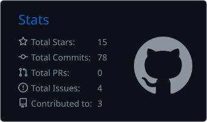
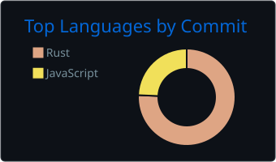

  

`software engineering` · `cloud` · `cybersecurity` · `developer tools`

 

I build across application development, cloud, security, automation, and AI. I'm a student, and most of what I know comes from shipping systems, breaking them, fixing them, and working out why they broke.

> I use AI to move faster, not to do my thinking. If I can't explain the code, test the edge cases, and account for the security decisions, I don't ship it.

## Now

| | |
|---|---|
| building | [Trawl](https://github.com/Yuv1s/Trawl), a browser-based CTF toolkit written in Rust and WebAssembly |
| building | [Zetesis](https://zetesis.dev), my software studio, and Sustain, its maintenance agent for custom apps |

## Zetesis

<table>
<tr>
<td width="62%" valign="top">

Zetesis is the studio I run at [Zetesis-dev](https://github.com/Zetesis-dev). It's home to my application, AI, and automation work, and it's where the tools I keep wishing existed get built. Sustain, its maintenance agent for custom apps, is the product I'm working on now.

It follows the same rule as everything else I ship: I have to be able to explain it, test it, and defend its security decisions.

[zetesis.dev](https://zetesis.dev) · [github org](https://github.com/Zetesis-dev) · [linkedin](https://linkedin.com/company/zetesis-dev)

</td>
<td width="38%" valign="top">

`app systems` 
`custom AI systems` 
`automation tooling` 
`maintenance agents`

</td>
</tr>
</table>

## Featured Projects

Trawl · browser-based CTF toolkit

 

[Trawl](https://github.com/Yuv1s/Trawl) is the project I'm pushing hardest right now. It's a browser-based toolkit for CTF analysis across steganography, cryptography, web challenges, and forensics.

A few decisions behind it matter more to me than the feature count:

* files stay on the user's machine instead of being uploaded somewhere
* the analysis core is written in Rust and compiled to WebAssembly
* the core has zero runtime dependencies
* parsers, detectors, decoders, and attacks are implemented inside the project
* detectors are tested against known-positive files and clean controls, not trusted because they look right

I like tools that let me get close to the mechanism, and Trawl gives me an excuse to do exactly that.

[try it](https://trawlctf.vercel.app) · [source](https://github.com/Yuv1s/Trawl) · [roadmap](https://github.com/Yuv1s/Trawl/blob/main/ROADMAP.md)

EzRegex · regex playground with plain-English explanations

 

[EzRegex](https://github.com/Yuv1s/EzRegex) makes regular expressions easier to inspect. It highlights matches live and explains a pattern piece by piece, using a hand-written tokenizer that walks through anchors, character classes, groups, escapes, quantifiers, alternation, and literals. The whole app runs client-side, with no backend and no API key.

It's also a fair picture of how I work with AI. Scaffolding and repetitive work can be sped up. The tokenizer, the behavior, the product decisions, and anything I need to understand stay mine.

[open the app](https://ezregex.vercel.app) · [source](https://github.com/Yuv1s/EzRegex)

## What I'm Working Toward

I'm drawn to the parts of software that make you understand what is happening underneath the abstraction. That pulls me toward developer tooling, security, cloud systems, and automation, and toward projects where correctness matters more than a good-looking demo.

I also compete in cybersecurity, and I spend time on Windows and Linux hardening, scripting, forensics, cryptography, and reverse engineering. It has made me more suspicious of assumptions, which is a useful habit when you write software.

What I Tend to Work With

 

Languages: `Rust` `Python` `JavaScript` `TypeScript` `Dart` `SQL` `Bash` `PHP` `C`

Application development: `React` `Svelte` `Flutter` `Firebase` `Firestore` `Stripe`

Cloud and infrastructure: `AWS` `Google Cloud` `Cloudflare` `Vercel` `MySQL`

Security: `Windows Hardening` `Linux Hardening` `Forensics` `Cryptography` `Reverse Engineering`

AI and automation: `OpenAI API` `Fine-tuning` `Prompt Engineering` `Workflow Automation`

 

  

## Activity

  
  

---

`build it` → `understand it` → `break it` → `fix it` → `ship it`

